# Awesome-App-Storefront-Management 🏪 🛒 ⚡

  

  
  
  
  
  

---

## 🌟 Top App Storefront Management Ecosystem 🚀

**Curated Directory of Commercial Marketplace Platforms & Open-Source Storefront Frameworks** 🛒  
*Focused on Multi-Vendor Onboarding 🤝, Commission Management 💰, Split Payments 💳, Headless Storefronts ⚡, Vendor Panels 📊 & Self-Hosted Marketplaces 📦*

**Last updated: October 2026** 📅

---

### 📌 Overview & SEO Summary 🔍
Welcome to the definitive, SEO-optimized directory of **app storefront management software** 🏪, **open-source multi-vendor marketplace platforms** 🔓, and **headless commerce frameworks** ⚡. Modern digital commerce requires robust tools for **vendor onboarding** 🤝, **commission structures** 💸, **catalog syndication** 📊, **split payments** 💳, and **custom developer APIs** 🛠️. Whether you are building an enterprise software app store (like *Salesforce AppExchange* ☁️ or *Mirakl* 🎯), a B2B distribution hub 🏢, or a developer-driven self-hosted marketplace using *Medusa* 🛒, *Spree Commerce* 🚀, or *Bagisto* 📦, this guide presents top commercial SaaS engines and open-source solutions complete with financial scale metrics 📈, pricing tiers 🏷️, and active GitHub developer stats ⭐.

#### 💡 Key SEO & Market Search Terms 🎯
* **Primary Keywords:** App Storefront Management 🏪, Open Source Marketplace Software 🔓, Multi-Vendor Marketplace Platform 🛒, Headless Storefront Framework ⚡, SaaS B2B App Store Builder 🏢.
* **Secondary Keywords:** Vendor Onboarding Automation 🤝, Marketplace Commission Engine 💰, Split Payment Gateway Integration 💳, Product Information Management (PIM) for Marketplaces 📊, Self-Hosted E-Commerce Engine 📦.

**Key Market Context & Benchmarks:** 📊
- **Salesforce AppExchange** dominates enterprise app marketplaces with **$250B+ parent market cap** ☁️, **6M+ total installs** 🚀, and usage across **89% of Fortune 100 companies** 🏢.
- **Mirakl** leads dedicated SaaS enterprise marketplace operations with **$3.5B+ valuation** 🎯, **450+ enterprise clients across 40 countries** 🌐, and **$699/month starting seller tier** 💸.
- **Bagisto & Medusa** lead open-source marketplace innovation with **28K+ and 31K+ GitHub stars** ⭐, delivering customizable multi-vendor models with zero platform transaction fees 🆓.
- **Spree Commerce** provides battle-tested Ruby/Next.js infrastructure powering **65,000+ product marketplaces** 🛍️ like Maisonette.

---

## 📑 Table of Contents 📖
- [🏢 SaaS & Commercial Platforms](#-saas--commercial-platforms)
- [🔓 Open-Source GitHub Projects](#-open-source-github-projects)
- [🛠️ How to Contribute](#%EF%B8%8F-how-to-contribute)
- [🤝 Support & Sponsorship](#-support--sponsorship)
- [📊 Star History](#-star-history)
- [⚠️ Disclaimer](#%EF%B8%8F-disclaimer)

---

## 🏢 SaaS / Commercial Platforms 🌐

> **Market Analysis & Size:** 📈 The global marketplace platform and app storefront management software market is estimated at **$7.5 Billion to $10.2 Billion in 2026**, growing at a **CAGR of ~16.5%** 🚀. The sector is **moderately fragmented** 🧩 — while enterprise CRM giants like Salesforce capture the upper enterprise tier, specialized marketplace infrastructure providers (Mirakl, CloudBlue), PXM engines (Salsify, Akeneo), and SMB solutions (CS-Cart) maintain strong market shares across distinct niches and verticals.

The table below ranks commercial SaaS platforms by parent company size (valuation / market capitalization, descending), detailing specific starting subscription tiers 🏷️ and explicit free trial / tier limits ⏳.

| SaaS / Commercial Platform | Company / Owner | Valuation / Market Cap | Standard Edition Starting Price | Free Tier / Free Trial Limits | Description |
| :--- | :--- | :--- | :--- | :--- | :--- |
| **[Salesforce AppExchange Store Builder](https://appexchange.salesforce.com/)** ☁️ | Salesforce | **~$250 Billion** 💼 | **$5/user/month** 💳 (Customer Community License; included for existing Salesforce orgs) | **Included with Salesforce Org** 🆓 (Free for existing subscription holders; Developer Org test sandbox available free for 30 days) | **Enterprise app marketplace builder** 🏢 — Create custom branded app marketplaces for customers and partners with 6M+ installs and built-in commerce workflows ⚡. |
| **[Mirakl](https://www.mirakl.com/)** 🎯 | Mirakl | **~$3.5 Billion** 💎 | **$699/month** 🏷️ (Mirakl Connect Growth Plan) / Quote-based (Enterprise Platform) | **No Free-Ever Plan** ⏳ (14-day guided sandbox demo upon request) | **Enterprise marketplace platform leader** 🌟 — Powers 450+ B2C/B2B marketplaces globally with seller onboarding, catalog ingestion, and automated commissions 💰. |
| **[Salsify](https://www.salsify.com/)** 🏢 | Salsify | **~$2.0 Billion** 🦄 | **$2,500/month** 💳 (Core PXM Package estimated) | **No Free-Ever Plan** ⏳ (14-day interactive product tour & demo sandbox) | **Product Experience Management (PXM)** 📊 — Combines PIM + DAM + digital shelf analytics for enterprise brands and marketplace sellers 🌐. |
| **[AppDirect](https://www.appdirect.com/)** 🟢 | AppDirect | **~$2.0 Billion** 🦄 | **$1,250/month** 💵 (Standard B2B Marketplace Plan) | **No Free-Ever Plan** ⏳ (30-day developer portal sandbox access) | **Subscription & B2B digital goods marketplace platform** 📲 — Manages complex recurring billing, app distribution, and multi-vendor product catalogs 🛒. |
| **[CloudBlue](https://www.cloudblue.com/)** 🔵 | CloudBlue (Ingram Micro) | **~$1.5 Billion** 💼 (Ingram Micro Unit) | **$1,500/month** 💳 (CloudBlue Connect SMB Tier) | **No Free-Ever Plan** ⏳ (30-day partner catalog demo trial) | **Digital product distribution engine** ⚙️ — Automates vendor contracting, order provisioning, software licensing, and multi-cloud catalog distribution ☁️. |
| **[Rithum](https://www.rithum.com/)** 🔗 | Rithum | **~$1.2 Billion** 💼 | **$1,000/month** 💵 (CommerceHub + ChannelAdvisor Unified Tier) | **No Free-Ever Plan** ⏳ (14-day channel simulation demo) | **E-commerce & retail marketplace network** 🛍️ — Connects brands to 420+ global marketplace channels with automated inventory feeds and retail media tools 📊. |
| **[Akeneo](https://www.akeneo.com/)** 📊 | Akeneo | **~$500 Million** 📈 | **$3,000/month** 💳 (SaaS Growth Edition) | **Open-Source Community Edition free forever** 🆓 (SaaS offers 14-day demo environment) | **Product Information Management (PIM)** 📂 — Centralizes product asset enrichment, multi-channel syndication, and marketplace catalog feeds 🌐. |
| **[Lengow](https://www.lengow.com/)** 🌐 | Lengow | **~$200 Million** 📊 | **$219/month** 🏷️ (€199/month Starter Plan) | **No Free-Ever Plan** ⏳ (14-day free trial limited to 1,000 product feed listings) | **E-commerce feed management software** ⚡ — Syndicates product catalogs across 1,600+ channels and marketplaces with real-time analytics 📈. |
| **[CS-Cart Multi-Vendor](https://www.cs-cart.com/)** 🛍️ | CS-Cart | **~$50 Million** 🏬 | **$660/year** 💳 ($55/month billed annually for Standard Edition) | **No Free-Ever Plan** ⏳ (15-day full-featured hosted free trial) | **Turnkey multi-vendor marketplace software** ⚙️ — Features vendor administrative panels, automated split payments, payouts, and 2,000+ add-on modules 🧩. |
| **[Arcadier](https://www.arcadier.com/)** 🔷 | Arcadier | **~$25 Million** 🚀 | **$79/month** 🏷️ (Express Basic Plan) | **No Free-Ever Plan** ⏳ (14-day free trial on Express plans with unlimited features) | **No-code marketplace builder** 🛠️ — Allows rapid deployment of multi-vendor storefronts for digital products, physical retail goods, and service bookings 🤝. |

---

## 🔓 Open-Source GitHub Projects 💻

*Sorted by GitHub Star Count (Descending)* 🌟

- **[Medusa](https://github.com/medusajs/medusa)**   
  **The world's most flexible commerce platform** ⚡, MIT licensed. **31K+ GitHub stars** ⭐ — **The ultimate modular headless commerce engine**. Built with Node.js/TypeScript + PostgreSQL. Features 22+ customizable commerce modules serving as the backbone for multi-vendor marketplaces, B2B storefronts, and custom app distribution platforms. 🛒

- **[Bagisto](https://github.com/bagisto/bagisto)**   
  **Free and open-source Laravel e-commerce framework** 🚀, MIT licensed. **28K+ GitHub stars** ⭐ — **Leading PHP multi-vendor marketplace engine**. Includes built-in multi-inventory management, multi-tenant SaaS features, vendor panels, order commission control, and native mobile app integrations out of the box. 📦

- **[Saleor](https://github.com/saleor/saleor)**   
  **Leading open-source MACH commerce platform** 🎯, BSD-3-Clause licensed. **23K+ GitHub stars** ⭐ — **GraphQL-first headless commerce engine** built on Python/Django. Offers modular multi-channel storefront management, enterprise REST/GraphQL APIs, webhooks, and 45+ dashboard extension points. ⚡

- **[Spree Commerce](https://github.com/spree/spree)**   
  **Open Source Platform for DTC, B2B Commerce & Marketplaces** 🛍️, BSD 3-Clause licensed. **16K+ GitHub stars** ⭐ — **Battle-tested Ruby on Rails & Next.js 16 storefront framework**. Includes vendor onboarding checklists, split seller order management, automated commission engines, and Stripe Connect payout ledgers in its core. Powers enterprise platforms like Maisonette's 65,000+ product marketplace. 🚀

- **[nopCommerce](https://github.com/nopCommerce/nopCommerce)**   
  **Free and open-source ASP.NET Core e-commerce platform** ⚡, GPL-2.0 licensed. **10K+ GitHub stars** ⭐ — **Top .NET open-source marketplace software**. Supports multi-store and multi-vendor architecture natively, enabling vendors to manage inventory, sales reporting, and shipping options independently. 🏢

- **[OpenCart](https://github.com/opencart/opencart)**   
  **Free open-source e-commerce platform** 🛍️, GPL-3.0 licensed. **8.2K+ GitHub stars** ⭐ — **Lightweight PHP e-commerce framework**. Features extensive multi-store capabilities, 13,000+ marketplace extensions, integrated payment gateways, and vendor management add-ons. 🏬

- **[Sylius](https://github.com/Sylius/Sylius)**   
  **Headless e-commerce framework for Symfony** 🎛️, MIT licensed. **8.0K+ GitHub stars** ⭐ — **Developer-first PHP e-commerce framework**. Highly customizable domain model and checkout pipeline designed for complex digital storefronts and B2B multi-tenant marketplaces. ⚙️

- **[Vendure](https://github.com/vendure-ecommerce/vendure)**   
  **TypeScript-first headless commerce framework** ⚡, MIT licensed. **5.5K+ GitHub stars** ⭐ — **Modern GraphQL commerce engine** built on NestJS & Fastify. Provides lightweight extensible architecture, vendor management plugins, and intuitive administrator panels. 🛠️

- **[Sharetribe](https://github.com/sharetribe/sharetribe)**   
  **Open-source peer-to-peer marketplace software** 🤝, Source Available / Apache 2.0 licensed. **2.4K+ GitHub stars** ⭐ — **Pioneer in rental, service, and peer-to-peer marketplace platforms**. Offers customizable booking engines, vendor listings, availability calendars, and payment processing. 📅

- **[Mercur](https://github.com/mercurjs/mercur)**   
  **The complete open source platform to run your entire marketplace** 🎯, MIT licensed. **1.2K+ GitHub stars** ⭐ — **Limitless open-source multi-vendor marketplace framework** built directly on MedusaJS. Features built-in vendor onboarding, multi-seller product offers, commission snapshotted rules, and Stripe Connect payouts out of the box. 💳

- **[OroCommerce](https://github.com/oroinc/orocommerce)**   
  **Flexible B2B commerce platform** 🏗️, OSL-3.0 licensed. **1.1K+ GitHub stars** ⭐ — **Enterprise B2B digital commerce engine**. Built on Symfony with deeply integrated CRM capabilities, buyer-seller corporate accounts, personalized price lists, and workflow engines. 📊

- **[Spryker Cloud Commerce OS](https://github.com/spryker/spryker)**   
  **Modular Commerce System for B2B, B2C, and Marketplace** 🏢, MIT/Proprietary licensed core. **850+ GitHub stars** ⭐ — **Enterprise composable commerce platform**. Designed for high-volume transactions, enterprise app marketplaces, and complex multi-vendor integrations. ⚡

- **[Tujjar](https://github.com/dev-taherm/Tujjar)**   
  **AI-powered, open-source e-commerce platform** 🧠, MIT licensed. **350+ GitHub stars** ⭐ — **Django & Next.js multi-tenant SaaS marketplace framework**. Features drag-and-drop page builders, 6 integrated AI providers, multi-vendor backend apps, and full REST APIs. 🤖

---

## 🛠️ How to Contribute 🤝

Contributions are highly encouraged! To add new app storefront software, SaaS tools, or open-source marketplace frameworks:

1. 🍴 **Fork** this repository.
2. 📝 **Add or edit** entries in `README.md` keeping formatting, pricing transparency, company valuation data, and exact star badges intact.
3. 🔗 Include official project links, exact starting tier prices, explicit free trial limits, and exact repository paths for GitHub star badges.
4. 🚀 Submit a **Pull Request** detailing your additions.

---

## 🤝 Support & Sponsorship 💖

Thank you for exploring and utilizing the **Awesome App Storefront Management** directory! 🌟 If this curated collection helps guide your technical architecture, e-commerce engine selection, or marketplace platform deployment, please consider supporting the project:

- ⭐ **Star** this repository on GitHub to increase visibility!
- 🔀 **Fork** and share with fellow marketplace engineers, software architects, and product managers.
- ☕ **Buy Me a Coffee / Sponsor**: Support continuous open-source curation and developer maintenance via the [GitHub Sponsor Dashboard](https://github.com/sponsors/ishandutta2007).

---

## 📊 Star History 📈

---

## ⚠️ Disclaimer ℹ️

- This directory is a **community-curated index** provided for informational, educational, and software evaluation purposes. ℹ️
- **Pricing & Market Valuations:** Company valuations, market caps, subscription starting prices, and free trial terms are based on public disclosures as of late 2026 and are subject to vendor updates. 📊
- **Open-Source Infrastructure:** Self-hosted open-source platforms (Medusa, Spree, Bagisto, Saleor, Mercur) require proper server provisioning (Node.js, PHP/Laravel, Python/Django, Ruby, PostgreSQL/Redis). Conduct thorough security and proof-of-concept testing prior to production deployment. 🏪

---

  <b>Made with ❤️ for marketplace operators, software engineers, and open-source storefront advocates.</b>

